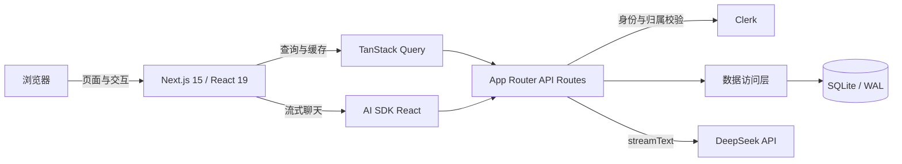

# DeepSeek Chat

一个基于 DeepSeek 模型的全栈 AI 对话应用。项目提供流式回复、历史会话管理、Markdown 渲染、模型切换、身份认证和本地持久化，可作为个人 AI 工作台或二次开发的基础项目。

## 产品功能

### AI 对话

- 支持 `DeepSeek Flash` 与 `DeepSeek V4 Pro`
- 模型回复实时流式展示，可随时停止生成
- 支持重新生成任意回复；重新生成历史分支成功后，会原子替换该回复及其后续消息
- 请求失败后可重试，并针对认证失败、余额不足、限流等常见模型错误给出提示
- 停止生成或连接中断时，自动保存已经收到的部分回复

### 内容与交互

- 支持 GFM Markdown、表格、链接、代码块和语法高亮
- 消息与代码均可一键复制
- `Enter` 发送，`Shift + Enter` 换行，并兼容中文输入法组合输入
- 输入草稿保存在当前浏览器会话中，新会话与各历史会话相互独立
- 阅读历史消息时不会强制滚动，可一键回到最新消息
- 提供写作、编程、学习和创意等快捷问题模板

### 会话管理

- 按置顶、今天、最近 7 天和更早时间组织会话
- 可按会话标题或消息正文搜索
- 支持置顶、重命名和删除会话
- 响应式侧栏，支持浅色、深色和跟随系统主题
- 快捷键：`Ctrl/Cmd + K` 聚焦搜索，`Ctrl/Cmd + Shift + O` 新建会话

### 账户与数据安全

- 使用 Clerk 登录并保护页面及 API 路由
- 每次会话读取、更新、删除和模型请求均校验当前用户的资源归属
- 消息客户端 ID 具有会话内唯一约束，重复提交不会重复入库
- Markdown 中的原始 HTML 不会执行，外部链接使用安全的新窗口属性

## 技术架构

项目采用 Next.js App Router 的单体全栈架构，页面、API 和数据访问层位于同一代码库中。



### 分层说明

| 层级       | 主要技术                                     | 职责                                       |
| ---------- | -------------------------------------------- | ------------------------------------------ |
| 表现层     | Next.js 15、React 19、MUI、原生 CSS          | 首页、会话页、响应式布局、主题与交互状态   |
| 客户端状态 | TanStack Query、AI SDK React                 | 服务端数据缓存、流式消息状态、失败重试     |
| 服务端接口 | Next.js Route Handlers                       | 参数校验、鉴权、会话管理与流式响应         |
| 模型接入   | Vercel AI SDK、`@ai-sdk/deepseek`            | 模型规范化、上下文组装、增量输出与错误转换 |
| 身份认证   | Clerk                                        | 登录、路由保护和用户身份解析               |
| 数据层     | `better-sqlite3`                             | 持久化、事务、索引及旧库自动迁移           |
| 内容渲染   | React Markdown、remark-gfm、rehype-highlight | Markdown、GFM 与代码高亮                   |
| 工程质量   | TypeScript、ESLint、Node Test Runner、JSDOM  | 类型检查、静态检查和自动化测试             |

### 核心数据流

1. 用户在首页提交问题，服务端创建会话，并将问题保存为 `initialPrompt`。
2. 会话页首次打开后发送初始问题；服务端先幂等写入用户消息，再从 SQLite 读取可信的完整上下文。
3. 服务端调用 DeepSeek，并通过 AI SDK Data Stream 将增量内容返回浏览器。
4. 回复完成、停止或部分异常时，服务端保存已生成内容并更新会话时间。
5. 重新生成时，旧分支只有在新回复成功到达后才被事务性替换。

服务端会阻止同一会话同时发起多个生成任务。该锁保存在当前 Node.js 进程内，因此多实例部署若需要严格的跨实例并发控制，应改用 Redis 或数据库锁。

### 数据模型

- `chats`：用户 ID、标题、模型、初始问题、置顶状态及创建/更新时间
- `messages`：所属会话、客户端消息 ID、角色与正文

SQLite 启用 WAL、外键和忙等待设置。应用首次访问数据库时自动创建 `data/chat.sqlite`、表和索引；已有旧数据库会在启动时补齐字段并保留数据。

### 目录结构

```text
src/
├─ app/
│  ├─ api/                 # 会话 CRUD、消息查询与模型流式接口
│  ├─ chat/[chat_id]/      # 会话页面
│  ├─ sign-in/             # Clerk 登录页面
│  ├─ layout.tsx           # 全局 Provider 与应用外壳
│  └─ page.tsx             # 新会话首页
├─ components/             # 会话、输入框、导航栏、Markdown 等组件
├─ db/                     # SQLite schema、连接与数据访问层
├─ lib/                    # 请求封装、服务端 API 包装与模型配置
└─ middleware.ts           # Clerk 路由保护
tests/                     # 数据层与聊天 UI 测试
data/                      # 本地 SQLite 数据（不提交到 Git）
```

## 本地开发

### 1. 环境要求

- Node.js 20 或更高版本（推荐使用当前 LTS）
- npm
- Clerk 应用
- DeepSeek API Key，或兼容 DeepSeek SDK 的 API 服务

### 2. 安装依赖

```bash
npm install
```

### 3. 配置环境变量

在项目根目录创建 `.env`：

```dotenv
NEXT_PUBLIC_CLERK_PUBLISHABLE_KEY=pk_...
CLERK_SECRET_KEY=sk_...
NEXT_PUBLIC_CLERK_SIGN_IN_URL=/sign-in
NEXT_PUBLIC_CLERK_SIGN_IN_FALLBACK_REDIRECT_URL=/
NEXT_PUBLIC_CLERK_SIGN_UP_FALLBACK_REDIRECT_URL=/

DEEPSEEK_API_KEY=sk_...
# 可选；不填写时使用 SDK 的默认地址
BASE_URL=https://api.deepseek.com/v1
```

不要提交 `.env`。仓库已通过 `.gitignore` 忽略所有环境变量文件。

### 4. 启动项目

```bash
npm run dev
```

访问 [http://localhost:3000](http://localhost:3000)。在 Windows PowerShell 执行策略阻止 `npm.ps1` 时，可使用 `npm.cmd run dev`。

## API 概览

所有接口均使用 `POST`，除 Clerk 登录页外均要求已登录。

| 路径                | 作用                               |
| ------------------- | ---------------------------------- |
| `/api/create-chat`  | 创建会话并保存初始问题             |
| `/api/get-chats`    | 查询当前用户的会话，支持内容搜索   |
| `/api/get-chat`     | 获取单个会话                       |
| `/api/get-messages` | 获取会话消息历史                   |
| `/api/update-chat`  | 重命名或置顶/取消置顶              |
| `/api/delete-chat`  | 删除会话及其全部消息               |
| `/api/chat`         | 发送消息或重新生成，并返回流式响应 |

这些 API 与当前 Web 客户端及 AI SDK 流格式配套。如需开放给第三方，建议另行增加版本化接口、速率限制和 API 级认证。

## 检查与构建

```bash
npm run check    # TypeScript 类型检查
npm run lint     # ESLint，禁止 warning
npm run test     # 数据层和 UI 自动化测试
npm run build    # Next.js 生产构建
npm start        # 启动生产服务（需先 build）
```

测试使用临时 SQLite 数据库和模拟模型响应，不调用真实 DeepSeek API。当前覆盖旧库迁移、用户隔离、搜索、消息幂等、分支替换、Markdown 安全渲染、输入法发送规则、复制、主题和流式交互等关键行为。

## 部署与数据备份

SQLite 方案适合本地运行，或具有持久化磁盘的单实例 Node.js 部署。无状态 Serverless、多实例或弹性扩缩容环境不应直接沿用本地 SQLite；规模化部署建议替换为 PostgreSQL 等共享数据库，并将进程内生成锁替换为分布式锁。

备份前建议停止应用，再复制整个 `data` 目录，以同时包含可能存在的 SQLite WAL 文件。恢复时也应整体恢复该目录。

生产部署还应：

- 妥善托管 Clerk 与 DeepSeek 密钥
- 为模型接口增加用户级限流、配额和审计
- 配置 HTTPS、日志、监控和备份策略
- 确认运行平台允许最长 120 秒的流式请求

## License

仓库当前未声明开源许可证。在添加许可证前，请勿默认将本项目视为可自由复制、修改或分发的软件。
